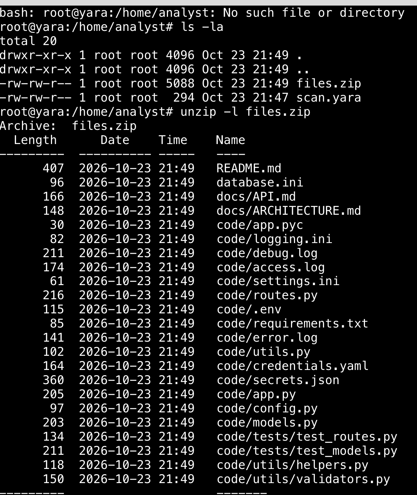
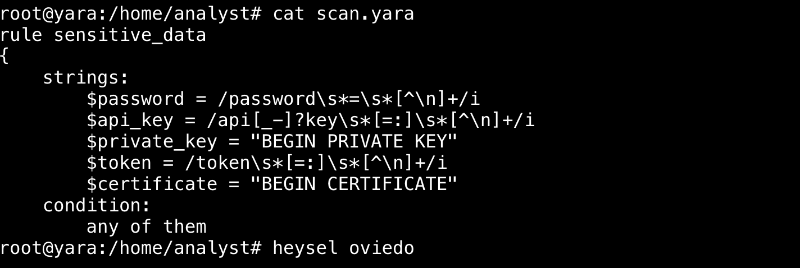
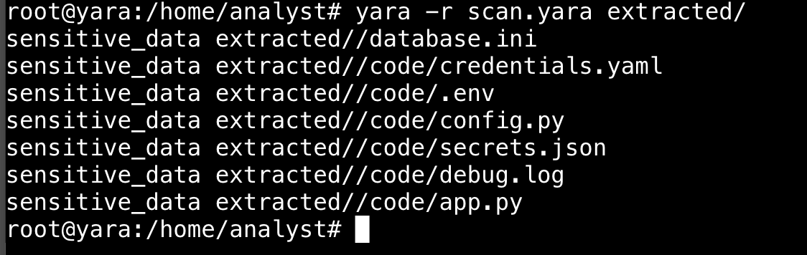
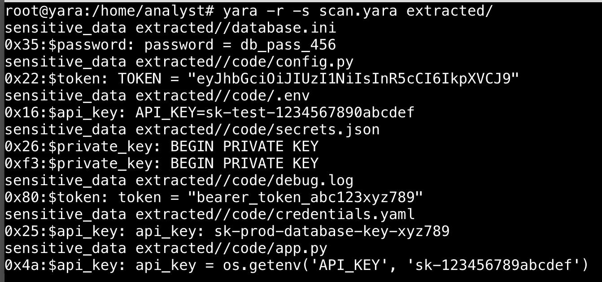

# YARA Sensitive Data Analysis

## Objective

Analyze a collection of 24 files using a provided YARA rule to identify files containing patterns associated with passwords, API keys, private keys, authentication tokens, and certificates. The investigation used Linux command-line tools to inspect the archive, examine the rule, scan the extracted files, and interpret the matches.

### Skills Learned

- Inspected ZIP archive contents before extraction.
- Read and interpreted a YARA rule with multiple string identifiers.
- Used recursive YARA scanning to identify matching files.
- Displayed the specific strings and identifiers that triggered a match.
- Distinguished the number of matching files from the number of unique pattern types.
- Practiced basic sensitive-data discovery and forensic triage.

### Tools Used

- Linux terminal
- `ls -la`
- `unzip -l`
- `unzip -d`
- `cat`
- `yara -r`
- `yara -s`

## Steps

### Step 1 - Locate the challenge files

Listed the contents of the working directory to locate the supplied YARA rule (`scan.yara`) and ZIP archive (`files.zip`).

```bash
ls -la
```

Both files were located in `/home/analyst`.

The directory listing is visible at the top of the archive screenshot in Step 2.

---

### Step 2 - Inspect the ZIP archive

Used `unzip -l` to list the archive contents without modifying or extracting the files.

```bash
unzip -l files.zip
```

The archive contained **24 files**, including configuration files, source code, and logs. Filenames such as `credentials.yaml`, `secrets.json`, and `.env` suggested potentially sensitive contents, but matching required examination of the file data.

<a href="images/archive-contents.png"></a>

*Ref 1: The screenshot shows the supplied files and the archive listing used in Steps 1 and 2.*

---

### Step 3 - Examine the YARA rule

Displayed the existing rule to understand what it looked for and how a file would qualify as a match.

```bash
cat scan.yara
```

The rule used five string identifiers:

- `$password`
- `$api_key`
- `$private_key`
- `$token`
- `$certificate`

Its `any of them` condition meant a file would match if at least one defined string pattern was present.



*Ref 2: The supplied rule contained five sensitive-data patterns and an `any of them` condition.*

---

### Step 4 - Extract the archive

Extracted the archive to a dedicated folder while preserving the original ZIP.

```bash
unzip files.zip -d extracted
```

This provided a directory tree for recursive scanning.

---

### Step 5 - Run the YARA scan

Used YARA's recursive option to evaluate the extracted files against the supplied rule.

```bash
yara -r scan.yara extracted/
```

The scan identified **7 matching files**:

```text
extracted/database.ini
extracted/code/credentials.yaml
extracted/code/.env
extracted/code/config.py
extracted/code/secrets.json
extracted/code/debug.log
extracted/code/app.py
```

**Result:** 7 of 24 files matched at least one pattern.



*Ref 3: Seven paths appeared in the recursive YARA scan output.*

---

### Step 6 - Identify matching strings and pattern types

Added `-s` to display the matching strings and their identifiers.

```bash
yara -r -s scan.yara extracted/
```

The output showed that `database.ini` matched the **`$password`** identifier. Across all seven matching files, four distinct indicators appeared:

- `$password`
- `$token`
- `$api_key`
- `$private_key`

The **`$certificate`** pattern did not appear in any matches.



*Ref 4: The `-s` output shows which patterns matched each file. The two `$private_key` occurrences in `secrets.json` count as one matching file and one pattern type.*

---

## Findings

| Question | Result |
| --- | --- |
| Files in archive | 24 |
| Files matching the YARA rule | **7** |
| Identifier matching `database.ini` | **`$password`** |
| Distinct matching identifiers | **4** |
| Pattern that did not match | **`$certificate`** |

## Conclusion

This exercise demonstrated how a prewritten YARA rule can quickly triage a collection of files for potential sensitive-data exposure. YARA matches are based on defined text patterns and do **not** independently prove that a discovered value is an active credential or secret. Follow-up inspection and validation would be needed in a real investigation.

## Evidence

The terminal screenshots are embedded beside the steps they document: archive inspection, rule examination, recursive scanning, and string-level results. The [challenge questions screenshot](images/challenge-questions.png) provides additional context for the findings. The original archive and rule file are not included in this repository; the screenshots contain values from the challenge output.
